# Farm2Door Relational Database ER Diagram

This document illustrates the Entity-Relationship (ER) model of the **Farm2Door** direct farmer-to-consumer marketplace.

```mermaid
erDiagram
    USERS ||--o| FARMER_PROFILES : "has"
    USERS ||--o| CONSUMER_PROFILES : "has"
    USERS ||--o{ ADDRESSES : "owns"
    USERS ||--o| CARTS : "has"
    USERS ||--o{ PRODUCTS : "produces (Farmer)"
    USERS ||--o{ ORDERS : "places (Consumer)"
    USERS ||--o{ REVIEWS : "writes (Consumer)"
    USERS ||--o{ NOTIFICATIONS : "receives"

    CATEGORIES ||--o{ PRODUCTS : "classifies"
    PRODUCTS ||--o{ PRODUCT_IMAGES : "has"
    CARTS ||--o{ CART_ITEMS : "contains"
    PRODUCTS ||--o{ CART_ITEMS : "added in"

    ORDERS ||--o{ ORDER_ITEMS : "contains"
    PRODUCTS ||--o{ ORDER_ITEMS : "ordered as"
    USERS ||--o{ ORDER_ITEMS : "fulfilled by (Farmer)"
    ADDRESSES ||--o{ ORDERS : "delivered to"

    ORDERS ||--o{ ORDER_STATUS_HISTORY : "tracks"
    ORDERS ||--|| PAYMENTS : "paid via"
    PRODUCTS ||--o{ REVIEWS : "rated by"
    ORDERS ||--o{ REVIEWS : "reviewed from"

    USERS {
        bigint id PK
        varchar email UK
        varchar password
        varchar full_name
        varchar phone
        varchar role "ROLE_FARMER | ROLE_CONSUMER | ROLE_ADMIN"
        boolean is_active
        timestamp created_at
        timestamp updated_at
    }

    FARMER_PROFILES {
        bigint id PK
        bigint user_id FK,UK
        varchar farm_name
        varchar farm_location
        decimal farm_size_acres
        int experience_years
        text bio
        boolean is_verified
        timestamp created_at
        timestamp updated_at
    }

    CONSUMER_PROFILES {
        bigint id PK
        bigint user_id FK,UK
        varchar default_phone
        varchar preferred_language
        timestamp created_at
        timestamp updated_at
    }

    ADDRESSES {
        bigint id PK
        bigint user_id FK
        varchar recipient_name
        varchar phone_number
        varchar street_address
        varchar city
        varchar state
        varchar postal_code
        boolean is_default
        timestamp created_at
    }

    CATEGORIES {
        bigint id PK
        varchar name UK
        varchar slug UK
        varchar description
        varchar image_url
        boolean is_active
        timestamp created_at
    }

    PRODUCTS {
        bigint id PK
        bigint farmer_id FK
        bigint category_id FK
        varchar title
        text description
        varchar unit "KG | GRAM | BUNCH | PIECE | LITER | DOZEN"
        decimal price_per_unit
        decimal stock_quantity
        decimal min_order_quantity
        varchar image_url
        varchar status "ACTIVE | INACTIVE | OUT_OF_STOCK"
        boolean is_featured
        decimal rating_average
        int review_count
        timestamp created_at
    }

    PRODUCT_IMAGES {
        bigint id PK
        bigint product_id FK
        varchar image_url
        boolean is_primary
        timestamp created_at
    }

    CARTS {
        bigint id PK
        bigint user_id FK,UK
        timestamp created_at
        timestamp updated_at
    }

    CART_ITEMS {
        bigint id PK
        bigint cart_id FK
        bigint product_id FK
        decimal quantity
        decimal unit_price
        timestamp created_at
    }

    ORDERS {
        bigint id PK
        varchar order_number UK
        bigint consumer_id FK
        bigint address_id FK
        varchar delivery_recipient_name
        varchar delivery_phone
        text delivery_address_text
        varchar status "PENDING | ACCEPTED | PROCESSING | READY_FOR_DISPATCH | DISPATCHED | DELIVERED | CANCELLED | REJECTED"
        varchar payment_method "CASH_ON_DELIVERY"
        varchar payment_status "PENDING | COMPLETED | FAILED | REFUNDED"
        decimal subtotal_amount
        decimal delivery_fee
        decimal total_amount
        varchar cancellation_reason
        text notes
        timestamp created_at
        timestamp updated_at
    }

    ORDER_ITEMS {
        bigint id PK
        bigint order_id FK
        bigint product_id FK
        bigint farmer_id FK
        varchar product_title_snapshot
        decimal unit_price_snapshot
        varchar unit_snapshot
        decimal quantity
        decimal subtotal
        varchar fulfillment_status
        timestamp created_at
    }

    ORDER_STATUS_HISTORY {
        bigint id PK
        bigint order_id FK
        varchar status
        varchar notes
        bigint changed_by_user_id FK
        timestamp created_at
    }

    PAYMENTS {
        bigint id PK
        bigint order_id FK,UK
        varchar payment_method
        varchar payment_status
        decimal amount
        varchar transaction_id
        timestamp created_at
    }

    REVIEWS {
        bigint id PK
        bigint product_id FK
        bigint consumer_id FK
        bigint order_id FK
        int rating
        text comment
        boolean is_verified_purchase
        timestamp created_at
    }

    NOTIFICATIONS {
        bigint id PK
        bigint user_id FK
        varchar title
        text message
        varchar type "ORDER_CREATED | ORDER_STATUS | LOW_STOCK | SYSTEM"
        boolean is_read
        varchar related_entity_type
        bigint related_entity_id
        timestamp created_at
    }
```

## Schema Highlights
1. **Financial & Precision Types**: Monetary columns (`price_per_unit`, `subtotal_amount`, `delivery_fee`, `total_amount`) use `DECIMAL(10,2)` and `DECIMAL(12,2)` to prevent floating-point inaccuracies.
2. **Auditing & Historical Integrity**: `order_items` stores historical snapshots (`product_title_snapshot`, `unit_price_snapshot`, `unit_snapshot`) preventing retroactive price or name alterations when products are updated in future seasons.
3. **Inventory Consistency**: Stock deductions and restorations occur in transactional boundaries. Unique constraints on `uk_cart_product` and `uk_consumer_product_order` prevent duplicate shopping cart entries and duplicate verified reviews.
