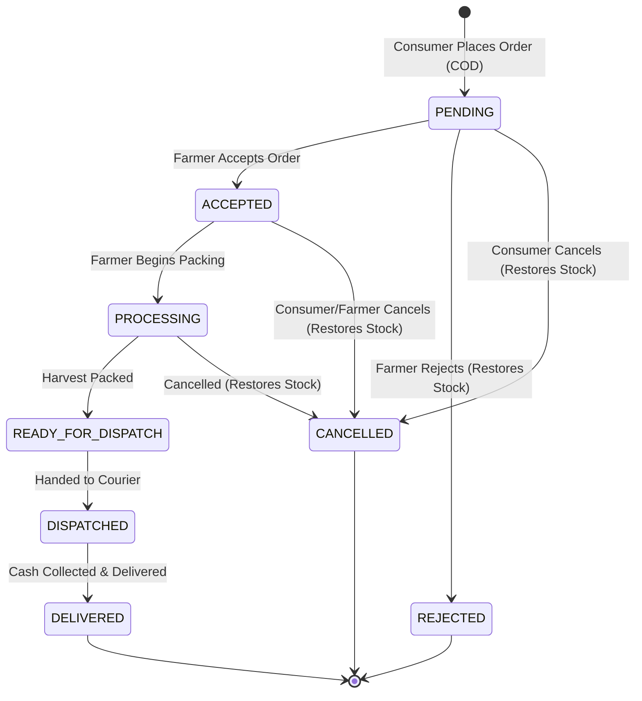

# Farm2Door — Direct Farmer-to-Consumer Marketplace
## Architecture & Engineering Overview

---

### 1. Executive Summary

**Farm2Door** is an enterprise-grade Java Full Stack marketplace engineered to eliminate predatory agricultural middlemen by connecting verified regional farmers directly to everyday household consumers. 

The platform guarantees transparency, fair producer pricing, harvest freshness, and end-to-end traceability through a modern decoupled architecture:
- **Backend**: Spring Boot 3.3.4 (REST API, Spring Security 6, JWT, Spring Data JPA, Hibernate, MySQL 8.x, Flyway migrations)
- **Frontend**: React 18, Vite, Tailwind CSS, Lucide React, Axios, React Hook Form
- **Database**: Relational MySQL with 15 normalized tables, foreign keys, composite indexes, and transactional concurrency guarantees.

---

### 2. User Roles & Permission Matrix

| Role | Access Scope | Capabilities |
| :--- | :--- | :--- |
| `ROLE_CONSUMER` | Public Marketplace & Consumer Portal | Browse catalog, filter by category/farm, manage shopping cart, manage multiple delivery addresses, place Cash on Delivery (COD) orders, track real-time fulfillment timeline, post verified reviews with star ratings and photos. |
| `ROLE_FARMER` | Producer Dashboard & Operations | Maintain farm biography, acreage, and location; list produce with high-res photos, unit pricing, stock levels, and min order quantities; receive incoming orders; transition fulfillment stages (`ACCEPTED` → `PROCESSING` → `READY_FOR_DISPATCH` → `DISPATCHED` → `DELIVERED`); monitor low-stock inventory alerts. |
| `ROLE_ADMIN` | Governance & Control Center | Inspect platform KPIs (gross sales, active listings, order volume); moderate produce catalog; toggle user account activations; verify authentic farmer producer credentials; manage category taxonomy; generate date-filtered sales analytics; export order records to CSV. |

---

### 3. Order Lifecycle State Machine



#### Atomic Inventory Guarantees:
- **Order Placement**: Inventory is atomically verified and decremented inside an `@Transactional` block. If any item has insufficient stock, the transaction immediately rolls back with an informative error.
- **Order Cancellation / Rejection**: Whenever an order transitions into `CANCELLED` or `REJECTED`, the exact purchased quantities are restored to the active stock in the database.

---

### 4. Technical Architecture

```
+---------------------------------------------------------+
|                  Client Web Browser                     |
|          React 18 + Vite + Tailwind CSS + Lucide        |
+---------------------------------------------------------+
                           |
                     HTTP / JSON (REST)
                  Bearer JWT Authentication
                           |
+---------------------------------------------------------+
|                   Spring Boot 3.3.4                     |
|  +--------------------+   +---------------------------+ |
|  | Spring Security 6  |   | Global Exception Handler  | |
|  | JWT Filter         |   | Swagger / OpenAPI 3       | |
|  +--------------------+   +---------------------------+ |
|  +--------------------+   +---------------------------+ |
|  | Controllers (REST) |   | Services (Transactional)  | |
|  +--------------------+   +---------------------------+ |
|  +--------------------+   +---------------------------+ |
|  | Spring Data JPA    |   | Flyway Migrations (V1,V2) | |
|  +--------------------+   +---------------------------+ |
+---------------------------------------------------------+
                           |
                     JDBC Connection
                           |
+---------------------------------------------------------+
|                       MySQL 8.x                         |
|   15 Normalized Tables with Foreign Keys & Indexes      |
+---------------------------------------------------------+
```

---

### 5. Frontend Design System

- **Primary Color (Emerald & Forest Green)**: Communicates fresh agriculture, organic soil, and vitality (`brand-600` `#16a34a`, `brand-700` `#15803d`).
- **Surface Neutrals**: Warm Stone (`stone-50` `#fafaf9`, `stone-100` `#f5f5f4`, `stone-900` `#1c1917`).
- **Accents**: Harvest Amber (`amber-500`), Crisp Rose (`rose-600`), Sky Blue (`sky-500`).
- **Typography**: Google Font *Plus Jakarta Sans* for modern, clear readability.
- **Glassmorphism**: Subtle translucent panels with `backdrop-blur-md` for floating navigation and elevated cards.
